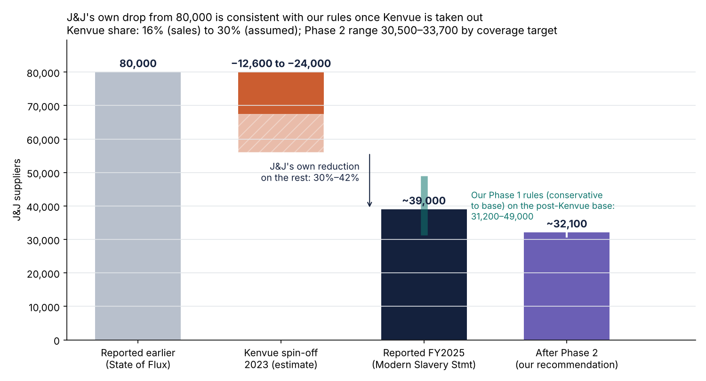
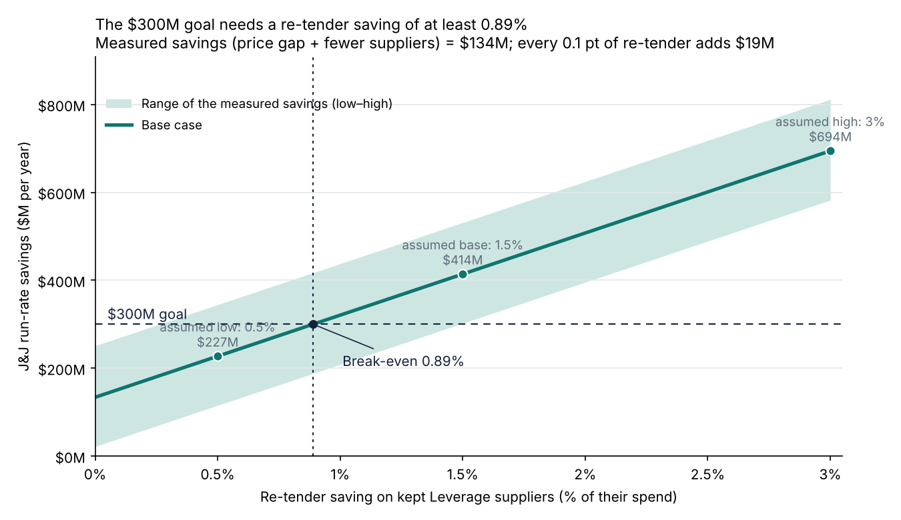

# J&J Supplier Rationalization

A supply chain case study: how a company like Johnson & Johnson decides which suppliers to keep, consolidate or exit, with a data reason behind every decision, and what agreements the kept suppliers should get.

**Portfolio page:** https://hemant-singla.github.io/projects/jnj-supplier-rationalization.html

**Headline:** J&J has been quoted at **80,000 suppliers** and now reports **~39,000** (FY2025). Part of that drop is the 2023 **Kenvue spin-off**; the rest (a 30–42% reduction) is the size our rules produce on real purchase data. From ~39,000, a second, category-level model with supply-risk limits takes J&J to **~32,100**. Savings at J&J scale: **$414M a year** in the base case for $73M one-time, of which **$134M is measured in the data**; the $300M goal needs a **re-tender saving of at least 0.89%**.

> J&J does not publish supplier-level data, so every method runs on **real public procurement data** (State of California purchase orders FY2012–15: 344,504 lines, 16,933 suppliers over three years, 8,226 active in the last year) and the results are scaled to J&J's published totals. Every assumption is labeled. Full story: [docs/08_jnj_timeline_and_phase2.md](docs/08_jnj_timeline_and_phase2.md).

## J&J's supplier count over time

| When | Suppliers | Source |
| --- | --- | --- |
| After 2014 (undated) | 80,000 | [State of Flux case study](https://stateofflux.co.uk/case-studies/johnson-and-johnson) |
| 2023 | Kenvue (consumer health) separated: IPO May, completed 23 Aug | [NJBIZ](https://njbiz.com/kenvue-completes-separation-from-jj) |
| 2024 | 29,000+ | [2024 Health for Humanity Report](https://healthforhumanityreport.jnj.com/2024/_assets/downloads/johnson-johnson-2024-health-for-humanity-report.pdf?h=EDX6Vl9g) |
| FY2025 | ~39,000 (new counting method) | [Global Modern Slavery Statement 2025](https://www.jnj.com/innovativemedicine/uk/global-modern-slavery-act-statement) |



- **Kenvue took an estimated 12,600–24,000 suppliers** (15.7% if in line with its share of 2022 sales, 30% as a high case; Kenvue publishes no count).
- **Phase 1 back-test:** our rules, applied to one year of active suppliers, cut 27% (conservative), 44% (base) or 52% (aggressive). On the post-Kenvue base that gives 31,200–49,000, bracketing the ~39,000 J&J reports. So J&J's own reduction is the size this method produces; it does not show J&J used these rules.
- **Phase 2 recommendation:** keep, per category, the fewest suppliers covering 90% of spend, with two or more in Strategic and Bottleneck categories, and always keep strategic, sole-source and small/diverse suppliers. That cuts a further 18%: **~39,000 → ~32,100** (30,500–33,700 by coverage target), with no change in how many categories one supplier dominates.

## What carries over to J&J, and what doesn't

| Carries over: the method | Does not carry over: the exact numbers |
| --- | --- |
| Cleaning raw spend data into addressable spend, with a reason code on every excluded line | The category mix: state purchasing is fuel, construction, IT and services; J&J buys APIs, medical-device components, lab supplies and contract manufacturing |
| Pareto / ABC segmentation and the spend cube | Prices and the measured price gaps (9.8% in Leverage, 5.2% in Non-critical) |
| The Kraljic matrix and one agreement type per quadrant | The shares behind the scaling: 44% fewer active suppliers, 87% of spend kept, $414M a year |
| Duplicate detection, the scorecard and keep / exit rules R1–R8 | Supply risk: regulated, validated manufacturing sites make switching suppliers far slower and costlier at J&J |
| The checks: concentration before vs after, sole-source protection, duplicate precision, tests | Public-sector rules (e.g. small-business set-asides) that shape California's supplier base |

So the J&J figures show the **size of the opportunity if the same patterns hold**, not a forecast. The California counts are per year of active suppliers, the same basis as J&J's reported counts. The first step with real J&J data would be to re-run the pipeline on its spend cube.

## Project steps

| # | Step | Answers | Method | Tools | Write-up |
| --- | --- | --- | --- | --- | --- |
| 0 | Business case | Is this worth doing? | Top-down savings model | Python | [docs/01_business_case.md](docs/01_business_case.md) |
| 1 | Load real data | What spend is addressable? | Cleaning rules with reason codes | pandas, SQLite | [data/README.md](data/README.md) |
| 2 | Spend cube + Pareto / ABC | Where does the spend sit? | SQL window functions | SQL | [docs/03_step2_spend_cube.md](docs/03_step2_spend_cube.md) |
| 3 | Kraljic matrix | How should each category be handled? | Value vs supply risk 2x2 | Python | [docs/04_step3_kraljic.md](docs/04_step3_kraljic.md) |
| 4 | Keep / consolidate / exit list | Which suppliers stay and which go? | Duplicate detection (ML) + scorecard + rules | scikit-learn, SQL | [docs/05_step4_decisions.md](docs/05_step4_decisions.md) |
| 4c | Supply-risk check | Does consolidation concentrate spend? | Top-supplier share per category, before vs after | Python | [docs/05_step4_decisions.md](docs/05_step4_decisions.md#does-consolidation-add-supply-risk) |
| 4d | Duplicate precision | Are matched records really one company? | 70 accepted pairs checked by hand | Python | [docs/05_step4_decisions.md](docs/05_step4_decisions.md#how-precise-is-the-duplicate-matching) |
| 5 | Savings model | What is it worth? | Measured price gap + low / base / high scenarios | Python | [docs/06_step5_savings.md](docs/06_step5_savings.md) |
| 5b | Sensitivity | How much rests on the assumption? | Savings vs re-tender rate, break-even | Python | [docs/06_step5_savings.md](docs/06_step5_savings.md#how-much-rests-on-the-re-tender-assumption) |
| 8 | Phase 2 | How could J&J go further from ~39,000? | Category target count with supply-risk floors | Python | [docs/08_jnj_timeline_and_phase2.md](docs/08_jnj_timeline_and_phase2.md#4-phase-2-how-jj-could-go-further-from-39000) |
| 9 | J&J back-test | Does the model explain J&J's real drop? | Reported counts over time, Kenvue spin-off, tiers applied | Python | [docs/08_jnj_timeline_and_phase2.md](docs/08_jnj_timeline_and_phase2.md#3-back-test-does-our-model-explain-jjs-own-reduction) |
| 6 | Dashboard | — | 4-page Power BI report (9 tables, 21 DAX measures) | Power BI | [powerbi/](powerbi/README.md) |
| 6b | Real J&J suppliers | Who are J&J's strategic suppliers? | SEC 10-K filings read | EDGAR | [docs/07_real_jnj_suppliers.md](docs/07_real_jnj_suppliers.md) |
| 7 | Agreements | — | MOU, MSA, supply agreement, catalog terms, transition notices | Markdown | [docs/agreements/](docs/agreements/README.md) |

## The three checks on the conclusion

**1. How much of the saving is assumed?** $280M of the $414M base case is the re-tender saving on kept Leverage suppliers, which the data cannot measure. Savings rise by $19M for every 0.1 point of re-tender saving; the $300M goal needs **0.89%** (0.26–1.49% across the measured range). The MSA template's volume tiers and benchmark clause are how that is tested.



**2. Does consolidation add supply risk?** Yes, a little, and it is now measured. Categories where the top supplier holds more than 50% of spend go from **129 to 136 of 406**: Strategic 9 → 9, Leverage 0 → 0, Bottleneck 95 → 99, Non-critical 25 → 28. Ten categories newly cross 50% ($64M over 3 years, 0.3% of active spend); they are listed in [`outputs/step4c_concentration_watchlist.csv`](outputs/step4c_concentration_watchlist.csv) and get a second-source clause. Every sole-source supplier (the only active company in a category) is kept by rule R2.

**3. Is the duplicate matching right?** Of 70 accepted pairs checked by hand: **20 of 20** exact name matches and **39 of 50** fuzzy matches (similarity 0.88–0.99) are the same company. That is about **96% precision** across all 1,065 accepted pairs, but only 78% in the fuzzy band, so fuzzy matches go to a review queue before records are merged. They touch $129M of 3-year spend (0.6%).

## Final deliverables

| Deliverable | File |
| --- | --- |
| Presentation (17 slides) | [docs/JnJ_Supplier_Rationalization_Deck.pdf](docs/JnJ_Supplier_Rationalization_Deck.pdf) |
| Business case | [docs/JnJ_Business_Case_Final.pdf](docs/JnJ_Business_Case_Final.pdf) · [Word](docs/JnJ_Business_Case_Final.docx) |
| Power BI dashboard | [powerbi/](powerbi/README.md) (open the `.pbip` in Power BI Desktop) · [PDF export](docs/JnJ_Supplier_Dashboard.pdf) |
| All step outputs, one tab per step, with live formulas | [outputs/JnJ_Supplier_Rationalization_Outputs.xlsx](outputs/JnJ_Supplier_Rationalization_Outputs.xlsx) |
| Agreement templates | [docs/agreements/](docs/agreements/README.md) |

## Repository layout

```
data/        data README and SEC supplier candidates (raw CSV is downloaded, not committed)
docs/        business case, methodology, step write-ups, agreements, PDFs, charts
model/       step-0 top-down business case model
outputs/     step CSVs and the outputs workbook
powerbi/     Power BI project (.pbip) and its data file
scripts/     pipeline, steps 01–07, and workbook builders
sql/         spend cube and fragmentation queries
tests/       checks on decisions, totals and the savings model
```

## Rebuild and test

```bash
pip install -r requirements.txt
# download the California CSV to data/raw/ (see data/README.md), then:
python scripts/01_clean_load.py data/raw/purchase-order-data-2012-2015-.csv
python scripts/02_spend_cube.py && python scripts/03_kraljic.py
python scripts/04a_duplicates.py && python scripts/04b_decisions.py
python scripts/04c_concentration.py && python scripts/04d_duplicate_precision.py
python scripts/05_savings.py && python scripts/05b_retender_sensitivity.py
python scripts/08_phase2_category_targets.py && python scripts/09_jnj_timeline_backtest.py
python scripts/build_outputs_workbook.py && python scripts/06_powerbi_data.py
pytest
```

The 21 tests check that strategic and sole-source suppliers are never exited, that the Phase 1 tiers are nested, that Phase 2 keeps every protected supplier, that the back-test brackets J&J's reported count, that every supplier has one decision and a reason code, that every raw row has a status and every exclusion a reason, that totals reconcile from the raw file to the decisions, and that the savings model adds up. Tests on committed outputs always run; tests that need the raw CSV or the SQLite database skip when those files are absent.

## Limitations

California public purchasing is a proxy: category mix, prices and supply risk differ from J&J's, so the J&J figures are scaled, not measured. J&J's 80,000 figure is undated and Kenvue's supplier share is estimated. $280M of the $414M base case is an assumption. No supplier quality, financial-risk or contract-term data was available; the price gap uses goods only. Small/diverse status comes from California certifications.

Progress log: [CHANGELOG.md](CHANGELOG.md).
