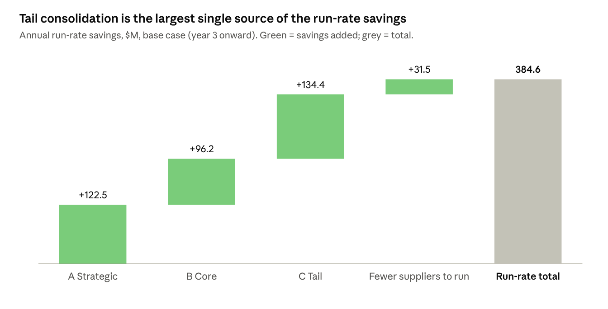
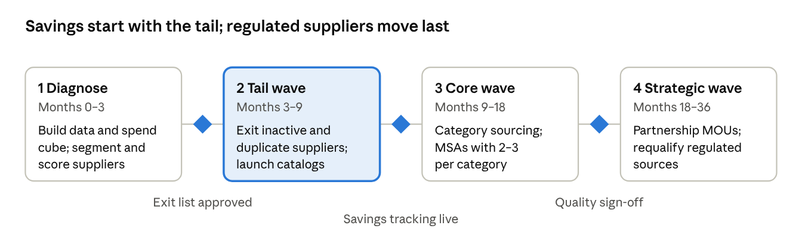

# J&J Supplier Rationalization: Business Case

Oct 20, 2026 · Hemant Singla

> Student case study built on J&J's public reporting plus clearly labeled assumptions. J&J's internal supplier data is not public.

## Executive summary

**Recommendation:** cut J&J's active supplier base from about 29,000 to about 13,300 (−54%) over three years, and put every retained supplier on a tiered agreement. Base case: **$385M a year in run-rate savings** (1.1% of ~$35B addressable spend) for **$59M one-time cost**, a 3-year NPV of **$584M** and payback inside the first year.

The cuts come almost entirely from the tail: ~14,800 suppliers that together hold about 8% of spend. Strategic suppliers, which hold ~70% of spend, are not cut. They move to deeper partnership agreements instead.

Even the low case (half the savings, 25% higher costs) returns an NPV of $248M.

## Current state

J&J already runs a large, shrinking supplier base: about 29,000 suppliers in 2024, down from 38,500 in 2023, after the 2023 separation of its consumer business (Kenvue).

| Metric | Value | Source |
| --- | --- | --- |
| Suppliers, 2024 | 29,000+ | [2024 Health for Humanity Report](https://healthforhumanityreport.jnj.com/2024/_assets/downloads/johnson-johnson-2024-health-for-humanity-report.pdf?h=EDX6Vl9g) |
| Suppliers, 2023 | 38,500+ | [2023 Health for Humanity Report](https://healthforhumanityreport.jnj.com/2023/_assets/downloads/johnson-johnson-2023-health-for-humanity-report.pdf?h=Ka9OvM1t) |
| Spend under procurement process | ~$35B across ~35,000 suppliers | [J&J job posting, Procurement Global Process Owner](https://www.careers.jnj.com/en/jobs/r-088156/director-procurement-global-process-owner/) |
| Tier 1 diverse supplier spend, 2022 | $3B | [J&J DEI in our supply base](https://belong.jnj.com/2022/driving-innovation/dei-in-our-supply-base.html) |
| Billion Dollar Roundtable member | 13 consecutive years (2023) | [2023 supplier diversity page](https://healthforhumanityreport.jnj.com/2023/accountability-innovation/responsible-supply-base/supplier-diversity-and-inclusion.html) |

The often-quoted figure of 80,000 suppliers appears to be an older, pre-separation number. This case uses the current ~29,000 baseline; the model re-runs on any baseline.

## The problem

Most of J&J's suppliers carry little spend but full overhead. In a typical Pareto-shaped base, about 85% of suppliers hold under 10% of spend, yet each one still needs onboarding, master data, compliance screening, invoices and payments.

- **Lost leverage:** the same category (lab supplies, MRO, IT services, travel, packaging) is bought from many vendors at many prices.
- **Process cost:** every active supplier costs an estimated ~$2,000 a year to maintain, before any audits.
- **Risk blind spots:** with tens of thousands of suppliers, risk monitoring (financial, ESG, cyber, sanctions) cannot go deep on each one.
- **Compliance exposure:** more suppliers means more third-party due diligence.

## Proposed approach

| Segment | Suppliers | Spend ($M) | Share of spend | Target cut | Suppliers after | Treatment |
| --- | --- | --- | --- | --- | --- | --- |
| A Strategic | 580 | 24,500 | 70% | 0% | 580 | Partnership agreements, joint value engineering |
| B Core | 3,770 | 7,700 | 22% | 25% | 2,828 | Consolidate per category to 2–3 preferred suppliers |
| C Tail | 24,650 | 2,800 | 8% | 60% | 9,860 | Move to preferred vendors, catalogs, marketplace |
| **Total** | **29,000** | **35,000** | **100%** | **54%** | **13,268** | |

**Rationalization rules**

1. **Never exit a regulated sole source** (FDA-validated API, excipient, component or contract manufacturer) without a qualified alternative and a requalification plan.
2. **Keep at least two qualified sources** for anything patient-critical.
3. **Protect diverse and small suppliers:** consolidate them into preferred-supplier and Tier 2 programs, so Tier 1 diverse spend stays at or above $3B.
4. **Exit first** where a supplier is inactive (no PO in 18 months), duplicated, or below a minimum spend threshold.
5. **Score the rest** on cost, quality, delivery, risk, ESG and diversity; the lowest-scoring supplier in a category exits first.

## Financial case

**One-time cost: $58.6M** — program team, analytics and tools ($15M), contracting and legal ($5M), supplier transition and requalification ($31M), plus 15% contingency.

| Scenario | Savings vs base | Cost vs base | Run-rate ($M/yr) | 3-yr savings ($M) | 3-yr NPV ($M) | ROI |
| --- | --- | --- | --- | --- | --- | --- |
| Low | 50% | 125% | 192 | 385 | 248 | 4.3x |
| Base | 100% | 100% | 385 | 769 | 584 | 12.1x |
| High | 130% | 90% | 500 | 1,000 | 783 | 18.0x |

Savings ramp 30% / 70% / 100% over years 1–3; 8% discount rate. Reproduce with `python model/business_case_model.py`.

## Agreements for retained suppliers

| Kraljic quadrant | Typical categories | Agreement | What it locks in | Term |
| --- | --- | --- | --- | --- |
| Strategic | APIs, biologics inputs, contract manufacturers | MOU / strategic partnership + supply agreement + quality agreement | Joint roadmap, capacity reservation, change control | 3–5 yrs |
| Bottleneck | Specialty excipients, single-source components | Long-term supply agreement + dual-sourcing plan | Safety stock, discontinuation notice, second source | 3–5 yrs |
| Leverage | Packaging, lab supplies, IT services, logistics | Master supply / services agreement (MSA) | Volume-tiered pricing, SLAs, rebates | 2–3 yrs |
| Non-critical | MRO, office supplies, travel | Catalog / marketplace / P-card | Fixed catalog pricing | 1–2 yrs |

An MOU records shared intent but is not binding on price or supply, so it always sits on top of a binding contract.

## Risks and guardrails

| Risk | Impact | Guardrail |
| --- | --- | --- |
| Supply disruption after exiting a source | Patient supply, revenue | Rules 1–2 |
| Requalification takes longer than planned | Savings delayed 12–24 months | Regulated changes in later waves |
| Breaking diversity commitments | Reputation, Roundtable status | Rule 3: $3B floor tracked monthly |
| Over-concentration on fewer suppliers | Pricing power shifts | Max share of wallet per category |
| Savings leakage (maverick buying) | Benefits not realized | Catalog and PO controls |
| Supplier relationship damage | Credo values, goodwill | Exit notices, 90-day wind-down |

## Roadmap and KPIs

| KPI | Baseline | Year 3 target |
| --- | --- | --- |
| Active suppliers | ~29,000 | ~13,300 |
| Run-rate savings | $0 | $385M a year |
| Spend under contract | Not public | 95% |
| Tier 1 diverse supplier spend | $3B (2022) | ≥ $3B |
| Critical items with 2+ qualified sources | Not public | 100% |

## Assumptions

| Assumption | Value |
| --- | --- |
| Addressable spend | $35B |
| Suppliers | 29,000 |
| Segment split (suppliers / spend) | A 2% / 70%, B 13% / 22%, C 85% / 8% |
| Price savings on addressed spend | A 0.5%, B 5%, C 8% |
| Annual cost to maintain one supplier | $2,000 |
| Transition cost per exited supplier | B $25,000, C $500 |
| Program + legal | $15M + $5M, plus 15% contingency |
| Savings ramp | 30% / 70% / 100% |
| Discount rate | 8% |
