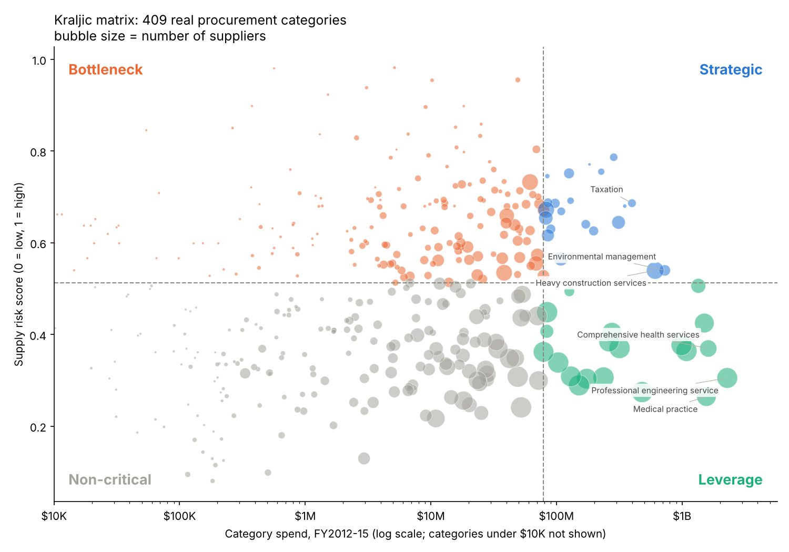

# Step 3 — How should each category be handled? (Kraljic matrix)

**Method:** each of 409 real categories (UNSPSC families) is placed on two axes measured from the data (`scripts/03_kraljic.py`):

- **Value** = category spend. High value = the largest categories that together make up 80% of spend (cut-off: $79M over 3 years).
- **Supply risk** = average of three percentile ranks: share of spend bought without competition (sole-source, emergency, special request), share held by the top 3 suppliers, and how few active suppliers the category has. Concentration and supplier count are ranked within size bands, so small categories aren't flagged just for being small. High risk = above the median.

## Result

| Quadrant | Categories | Spend | % of spend | Supplier relationships | How to handle it |
| --- | --- | --- | --- | --- | --- |
| Leverage | 20 | $12.91B | 59.3% | 12,663 | Competitive tender; MSA with 2–3 preferred suppliers |
| Strategic | 21 | $4.55B | 20.9% | 3,231 | Partnership MOU + supply agreement; joint planning |
| Bottleneck | 183 | $2.78B | 12.8% | 10,341 | Long-term supply agreement + qualify a second source |
| Non-critical | 185 | $1.53B | 7.0% | 21,991 | Catalog / marketplace / purchasing card |

(Supplier relationships count a supplier once per category it sells in, so they add up to more than 16,933.)

## What it means

1. **Most of the money is in leverage categories (59%).** Engineering, health services, consulting, HR and computer services are large, competitive markets with hundreds of suppliers each. This is where consolidating to 2–3 preferred suppliers drives the price savings.
2. **Non-critical categories hold the most supplier relationships for the least money:** 21,991 relationships for 7% of spend (paper, lab equipment, vehicle parts, test instruments). These go to catalogs and purchasing cards, which is how most tail suppliers exit.
3. **Strategic categories are few but concentrated.** Fuels: top 3 suppliers hold 94%. Heavy construction: 26% bought without competition. These suppliers are kept and moved to partnership agreements, not cut.
4. **Bottleneck categories need a second source, not fewer sources.** 183 small categories depend on a few suppliers; the risk there is losing a supplier, so rationalization must not cut them further.

## Mapping to J&J

| Quadrant | California example | J&J equivalent |
| --- | --- | --- |
| Leverage | Engineering, consulting, IT services | Packaging, lab supplies, IT services, logistics |
| Strategic | Fuels, heavy construction | APIs, biologics inputs, contract manufacturers |
| Bottleneck | Specialty safety and transport equipment | Specialty excipients, single-source device components |
| Non-critical | Paper, vehicle parts, test instruments | MRO, office supplies, small services |

Limitation: public data carries no regulatory flag, so risk here is market-based only. At J&J, any GMP-qualified or patient-critical input would be forced into Strategic or Bottleneck regardless of score.

Output tables: `outputs/step3_kraljic_categories.csv` (all 409 categories with quadrant and agreement), `outputs/step3_kraljic_summary.csv`.
