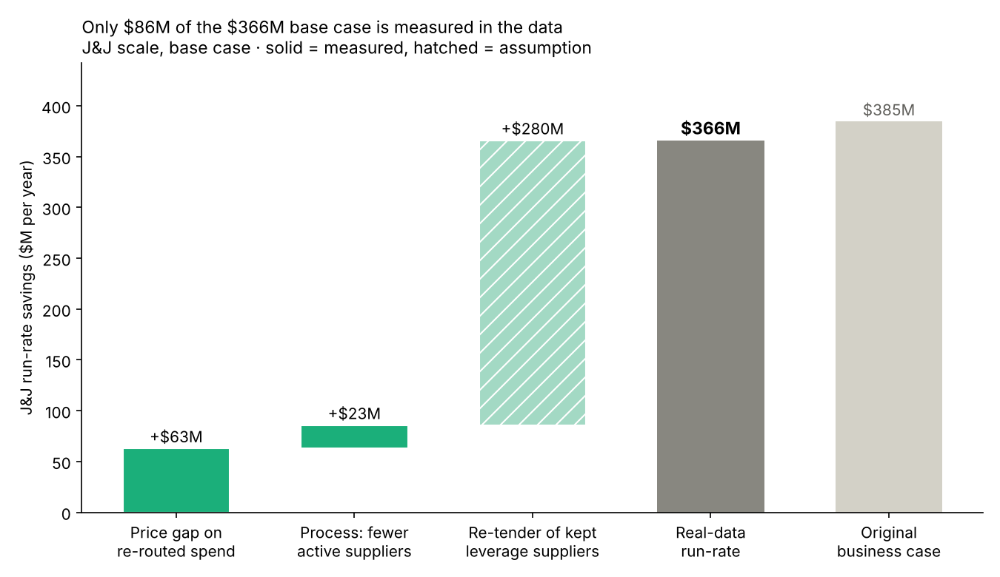

# Step 5 — What is it worth? Savings on the real keep / exit list

**Method** (`scripts/05_savings.py`; live version in tab `5_Savings_Real_List` of the outputs workbook): every step-4 decision is tied to one savings lever. Spend is annualized (3-year total ÷ 3).

| Lever | Applies to | Rate | Basis |
| --- | --- | --- | --- |
| Price gap | Spend re-routed from one-time (R5) and consolidated (R8) suppliers: $401M/yr | Measured gap by quadrant × share captured (low 0 / base ½ / high full) | **Measured** |
| Re-tender | Kept suppliers in Leverage categories: $3,892M/yr | 0.5% / 1.5% / 3% | **Assumption** |
| Process | 6,671 active supplier records removed (R3, R5, R8) | $1,000 / $2,000 / $3,000 per supplier per year | Assumption on a measured count |
| — | Inactive suppliers (R4) | $0: their spend already stopped | — |

Scaled to J&J: price and re-tender savings by spend ($35B ÷ $7.3B), process savings and transition cost by supplier count (29,000 ÷ 16,933).

## The price-gap test

Does an exiting supplier charge more than a kept supplier for the **same item**? Goods only (services aren't comparable per unit), same UNSPSC code and item name, at least 3 purchase lines on each side, median unit price.

| Quadrant | Items compared | Median gap (exiting supplier dearer = +) | Items where exiting supplier was dearer |
| --- | --- | --- | --- |
| Leverage | 24 | +9.8% | 67% |
| Non-critical | 52 | +5.2% | 62% |
| Bottleneck | 41 | −10.0% | 34% |
| Strategic | 10 | −7.2% | 30% |

**Finding:** consolidating pays only in Leverage and Non-critical categories. In Bottleneck and Strategic categories the small suppliers were *cheaper*, which supports the step-3 rule not to consolidate them. All 127 item comparisons are in `outputs/step5_price_gap_goods.csv`.

## Result (J&J scale)

| | Low | Base | High |
| --- | --- | --- | --- |
| Price gap on re-routed spend | $0M | $63M | $126M |
| Re-tender of kept leverage suppliers | $93M | $280M | $561M |
| Process: fewer active suppliers | $11M | $23M | $34M |
| **Run-rate savings per year** | **$105M** | **$366M** | **$721M** |
| Of which measured in the data | $11M | $86M | $160M |
| One-time cost | $40M | $40M | $40M |
| 3-year NPV (8%, ramp 30/70/100%) | $135M | $572M | $1,165M |
| Meets the $300M goal? | No | Yes | Yes |

## What it means

1. **The base case ($366M a year) is close to the original business case ($385M)**, but the mix is very different: the original leaned on a 5–8% price saving on moved spend, while the data supports only ~5–10% in two quadrants and none in the others.
2. **Only $86M a year (23%) is measured in the data.** The rest depends on re-tendering kept leverage suppliers, which this data can't test.
3. **What has to be true:** to reach the $300M goal, the re-tender must save **at least 1.15%** on kept leverage spend in the base case. That's the number to test first in a pilot sourcing wave.
4. **The program pays back fast in every scenario:** one-time cost is $40M; even the low case returns a positive NPV ($135M).

## Limitations

- Unit prices are noisy (units differ: "diesel fuel" can be a gallon or a load), so the gap is a median over a small sample (127 items).
- California's prices stand in for J&J's; pharma and medtech direct materials are not in this data.
- Transition costs per supplier are assumptions.
