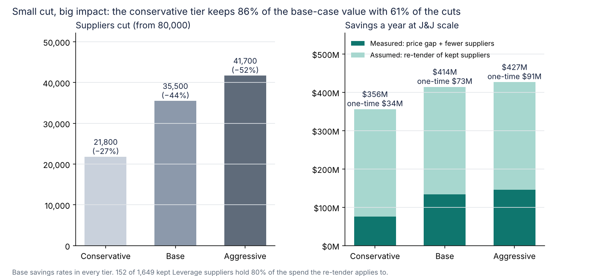

# J&J's supplier count over time, the Kenvue spin-off, and Phase 2

**Why this page exists:** an earlier version scaled the results to 29,000 suppliers and showed a cut to ~4,600 on the California data. A reader pointed out that J&J has been quoted at ~80,000 suppliers and that cutting most of them is not realistic. Both points were fair. This page rebuilds the J&J side around what J&J has actually reported over time.

## 1. What J&J has reported

| When | Suppliers | Source | What it covers |
| --- | --- | --- | --- |
| After 2014 (undated) | 80,000 | [State of Flux case study](https://stateofflux.co.uk/case-studies/johnson-and-johnson) | J&J including its consumer business; procurement had just become one enterprise function |
| 2021 | 78,000+ | [ArcGIS StoryMap, "Johnson & Johnson Supply Chain"](https://storymaps.arcgis.com/stories/efd9fb73ac4f4e8082036d6296aea5a2) | Individual author (Jan 2021), no source given; dates the ~80,000 figure to before the Kenvue spin-off |
| Later (undated) | 50,000+ | [Procurement Magazine](https://procurementmag.com/digital-procurement/johnson-johnson-centralising-procurement-with-technology) | Whole company |
| 2023 | 38,500+ | 2023 Health for Humanity Report | Year of the Kenvue separation |
| 2024 | 29,000+ | [2024 Health for Humanity Report](https://healthforhumanityreport.jnj.com/2024/_assets/downloads/johnson-johnson-2024-health-for-humanity-report.pdf?h=EDX6Vl9g) | J&J after Kenvue |
| FY2025 | ~39,000 | [Global Modern Slavery Statement 2025](https://www.jnj.com/innovativemedicine/uk/global-modern-slavery-act-statement) | New spend-classification method, so not directly comparable with 2024 |

The counts move with the business and with how suppliers are counted. This project uses **80,000 as the starting point** and **~39,000 as today**.

## 2. Not all of the drop is rationalization: the Kenvue spin-off

In 2023 J&J separated its consumer health business as **Kenvue** (IPO in May 2023; separation completed on 23 August 2023 through an exchange offer, [NJBIZ](https://njbiz.com/kenvue-completes-separation-from-jj)). Kenvue's suppliers left with it. Kenvue does not publish a supplier count ([10-K FY2023](https://www.sec.gov/Archives/edgar/data/1944048/000194404824000057/kvue-20231231.htm) says only "a vast supplier base"), so its share is estimated two ways:

| Case | Kenvue's share of J&J suppliers | Basis | J&J suppliers left after Kenvue |
| --- | --- | --- | --- |
| Low | 15.7% | Consumer Health was $14,953M of J&J's $94,943M sales in 2022 ([J&J FY2022 results](https://www.businesswire.com/news/home/20230124005275/en)) | ~67,400 |
| High | 30% (assumption) | Consumer goods lean heavily on packaging, fragrance and contract manufacturers | ~56,000 |

From there to ~39,000 is J&J's own reduction: **30–42%**.

## 3. Back-test: does our model explain J&J's own reduction?

Phase 1 (steps 4–5) sorts one year of active suppliers (FY2014–15, 8,226 suppliers in the California data, the same kind of count J&J reports) into three tiers:

| Tier | What changes | Share of the year's active suppliers |
| --- | --- | --- |
| Conservative | Merge duplicate records; move one-time vendors to catalog | −27% |
| Base | + consolidate within Leverage and Non-critical categories | −44% |
| Aggressive | + consolidate in Strategic and Bottleneck categories too | −52% |

Applied to the post-Kenvue base (56,000–67,400), the conservative-to-base tiers give **31,200–49,000** suppliers. J&J reports **~39,000**. So J&J's own reduction is the size our rules would produce, between the conservative and base tiers. This does not show that J&J used these rules, only that a reduction of that size is achievable with defensible, reason-coded decisions.

Moving one-time vendors to a catalog is not the same as calling them useless: they stay available to buyers, but procurement no longer manages each one individually. That is where most of the reduction comes from.

## 4. Phase 2: how J&J could go further from ~39,000

Phase 1 used blanket rules. Once those are done, the remaining suppliers are mostly legitimate, so a different model is needed: a **category target count** with supply-risk limits (`scripts/08_phase2_category_targets.py`).

For each category, keep the smallest set of suppliers that covers 90% of its spend, with at least two suppliers in Strategic and Bottleneck categories. Strategic, sole-source and small/diverse suppliers are always kept. Everyone else moves their volume to the category's core suppliers or to the catalog.

| | Result |
| --- | --- |
| Suppliers managed after Phase 1 (California, FY2014–15) | 4,580 |
| Protected (strategic, sole source, small/diverse) | 3,114 |
| Kept after Phase 2 (90% coverage) | 3,765 (−18%) |
| Spend that changes supplier | $119M, 1.5% of the year's spend |
| Categories where one supplier holds > 50% of spend | 161 before, 161 after (of 382) |
| **J&J: ~39,000 → after Phase 2** | **~32,100** (30,500 at 80% coverage to 33,700 at 95%) |
| J&J process savings | ~$14M a year at $2,000 per supplier |

Phase 2 is smaller than Phase 1, as it should be: the easy reductions are already done. Its value is fewer relationships to manage and audit at almost no supply-risk cost, not large price savings. The coverage target is the lever: 80% coverage cuts more, 95% keeps more redundancy.

## 5. Small cut, big impact

Cutting a supplier is not free: each one needs a reason, a transition notice and agreement from the people who buy from it. So the question is how much value each extra cut adds (`scripts/05c_value_vs_cuts.py`, same base savings rates in every tier):

| Tier | Suppliers cut (from 80,000) | Savings a year | Of which measured | One-time cost |
| --- | --- | --- | --- | --- |
| **Conservative** (duplicates + one-time vendors to catalog) | **21,800 (−27%)** | **$356M** | $76M | **$34M** |
| Base (+ consolidate Leverage and Non-critical) | 35,500 (−44%) | $414M | $134M | $73M |
| Aggressive (+ consolidate Strategic and Bottleneck) | 41,700 (−52%) | $427M | $146M | $91M |

- The conservative tier captures **86% of the base-case value with 61% of the cuts**, and its cuts are the easiest to defend: a duplicate record is the same company, and a one-time vendor stays available through the catalog.
- Going from conservative to base cuts 13,700 more suppliers for $58M a year and $39M more one-time cost. Going to aggressive cuts 6,200 more for $12M a year, roughly just the cost of managing them, and adds supply risk.
- **The value is in the suppliers J&J keeps.** The re-tender saving ($280M) needs few cuts, and 152 of the 1,649 kept Leverage suppliers hold 80% of that spend. Negotiating with ~150 large suppliers is worth more than cutting thousands of small ones.
- **Caveat:** in the conservative plan only $76M is measured; the $300M goal then needs a re-tender saving of at least 1.20% (0.89% in the base plan). The savings lower costs, so they show up in operating profit, not revenue.

**Recommendation:** start with the conservative tier and a re-tender of the ~150 largest Leverage suppliers. Consolidate further only in Leverage and Non-critical categories where a category owner can show the price gap, and use the Phase 2 category targets as the guide.

## Savings with the 80,000 baseline

Price and re-tender savings scale with spend ($35B), so they don't change. Savings from managing fewer suppliers scale with the supplier count, so they rise. Base case: **$414M a year** ($63M measured price gap + $71M fewer suppliers + $280M assumed re-tender), one-time cost $73M, 3-year NPV $619M. **$134M (32%) is measured in the data**, and the $300M goal needs a re-tender saving of **0.89%** (1.49% in the low case).

## Limitations

The 80,000 and 50,000 figures are undated. Kenvue's supplier share is estimated, not reported. The FY2025 count uses a new counting method. The California data is a proxy for J&J's category mix and prices. The back-test shows the model can produce a reduction of the size J&J achieved; it does not show how J&J did it.
